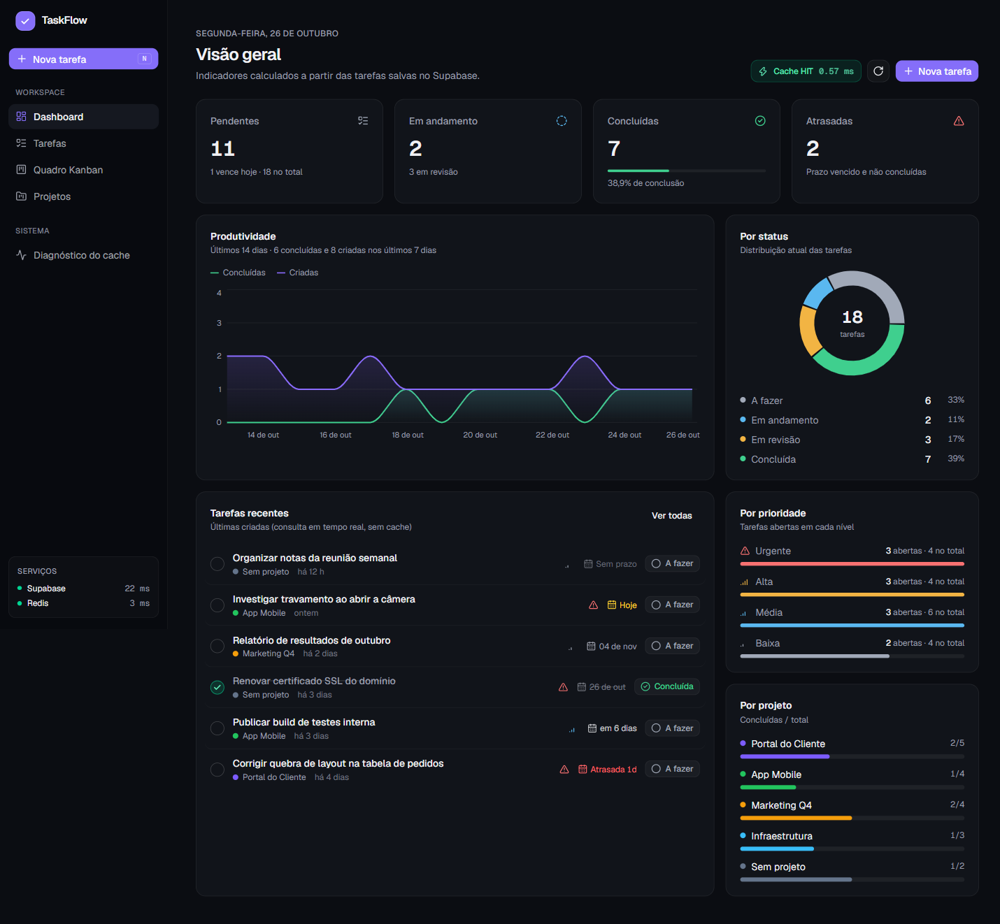
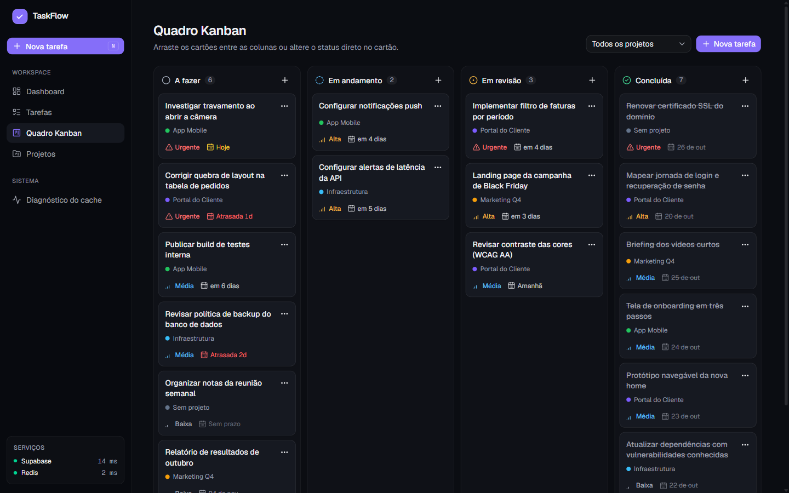
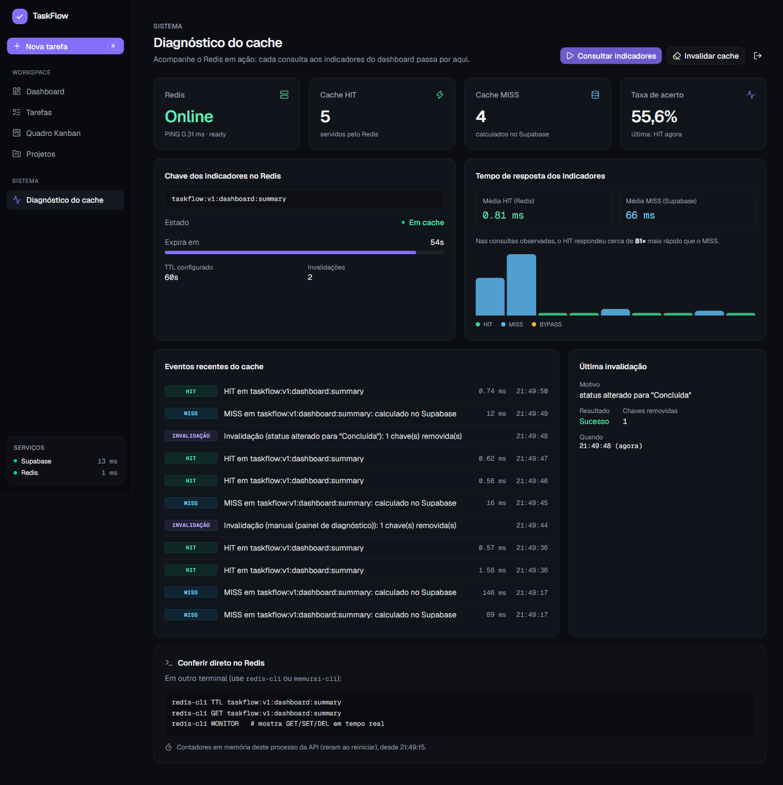
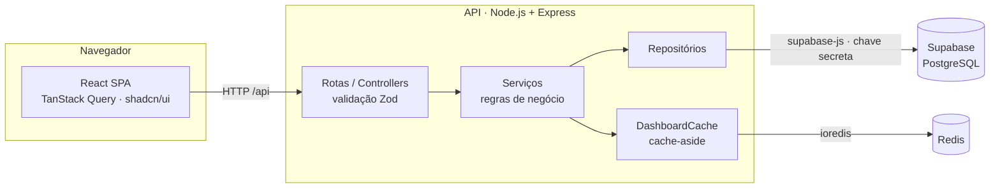

<div align="center">


# TaskFlow

**Gestão de tarefas e projetos com indicadores de produtividade em tempo real.**

PostgreSQL no Supabase como fonte da verdade · Redis como cache dos indicadores · React + Node.js em TypeScript

[](https://nodejs.org)
[](https://www.typescriptlang.org)
[](https://react.dev)
[](https://supabase.com)
[](https://redis.io)
[](LICENSE)

</div>



## Visão geral

O TaskFlow organiza tarefas por projeto, prioridade, prazo e status. Ele mostra o que está atrasado, o que vence hoje e como a produtividade evolui ao longo dos dias.

A interface fala somente com uma API REST. A API persiste tudo no **Supabase (PostgreSQL)** e serve os indicadores do dashboard a partir de um **cache Redis** com invalidação automática a cada alteração. Um painel técnico mostra o cache funcionando: HIT, MISS, TTL e invalidações em tempo real.

## Funcionalidades

- **Dashboard**: pendentes, em andamento, concluídas, atrasadas e taxa de conclusão; gráfico de criadas × concluídas em 14 dias; distribuição por status, prioridade e projeto.
- **Tarefas**: criação, edição e exclusão; busca por título; filtros por status, prioridade, projeto e atraso; ordenação; paginação; conclusão em um clique. Os filtros ficam na URL e podem ser compartilhados.
- **Quadro Kanban**: arrastar e soltar entre colunas no desktop; abas por coluna e menu de status no celular.
- **Projetos**: cor, descrição e progresso. Excluir um projeto mantém as tarefas, que ficam sem projeto.
- **Histórico**: cada alteração de status, prioridade, prazo, projeto ou conteúdo é registrada pelo próprio banco.
- **Diagnóstico do cache**: estado do Redis, contadores de HIT/MISS, TTL em contagem regressiva, tempos médios e linha do tempo de eventos, com acesso protegido por token.
- **Experiência**: tema escuro, layout responsivo de 390 px ao desktop, atalho <kbd>N</kbd> para nova tarefa, navegação por teclado, estados de carregamento, vazio e erro.

<table>
  <tr>
    <td width="50%"></td>
    <td width="50%"></td>
  </tr>
  <tr>
    <td align="center">Quadro Kanban</td>
    <td align="center">Diagnóstico do cache: MISS × HIT e invalidação</td>
  </tr>
</table>

## Stack

| Camada    | Tecnologias                                                                                                                                    |
| --------- | ---------------------------------------------------------------------------------------------------------------------------------------------- |
| Front-end | React 19, TypeScript, Vite 8, Tailwind CSS 4, shadcn/ui (Radix), TanStack Query, React Router, React Hook Form, Zod, Recharts, dnd-kit, Lucide |
| Back-end  | Node.js 22+, Express 5, TypeScript, Zod, supabase-js, ioredis, pino, helmet                                                                    |
| Dados     | Supabase (PostgreSQL 17) com migrations, triggers e Row Level Security                                                                         |
| Cache     | Redis 7 (compatível com Memurai e Upstash)                                                                                                     |
| Qualidade | Vitest, Supertest, ESLint, Prettier                                                                                                            |

## Arquitetura



- O navegador só conversa com a API. Ele não acessa o Redis e não recebe chaves do Supabase.
- A API é organizada em camadas (rotas → controllers → serviços → repositórios), com dependências injetadas. Nos testes, Supabase e Redis são substituídos por dublês.
- Regras críticas ficam no banco: constraints, `updated_at` e `completed_at` automáticos e histórico gravado por trigger na mesma transação da alteração.

Detalhes, modelo de dados e decisões de projeto: **[docs/arquitetura.md](docs/arquitetura.md)**.

### Cache dos indicadores

O dashboard é a tela mais acessada e a mais cara de montar: agrega todas as tarefas por status, prioridade, prazo e dia. O resultado só muda quando algo é alterado, então ele é guardado no Redis com o padrão **cache-aside**:

| Situação       | Comportamento                                                                         | Tempo medido                    |
| -------------- | ------------------------------------------------------------------------------------- | ------------------------------- |
| **HIT**        | Indicadores lidos do Redis, sem tocar no banco                                        | 0,4–0,7 ms                      |
| **MISS**       | Cálculo no Supabase e gravação no Redis com TTL de 60 s                               | 165–420 ms (Supabase us-east-1) |
| **Escrita**    | Criar, editar ou excluir tarefa/projeto remove a chave; o próximo acesso recalcula    | —                               |
| **Redis fora** | Resposta direta do Supabase (`BYPASS`); a invalidação pendente é refeita na reconexão | —                               |

- Chave versionada: `taskflow:v1:dashboard:summary`.
- Um contador de geração com script Lua impede que um cálculo concorrente grave dados anteriores a uma alteração.
- O TTL de 60 s limita o atraso de alterações feitas fora da API, como edições diretas no painel do Supabase.

Cada resposta informa a origem dos dados no cabeçalho `X-Cache` (`HIT`, `MISS` ou `BYPASS`).

## Começando

### Pré-requisitos

- Node.js **22.22+** e npm
- Um projeto [Supabase](https://supabase.com) (ou Docker + [Supabase CLI](https://supabase.com/docs/guides/local-development) para rodar localmente)
- Redis: `docker compose up -d redis`, [Memurai](https://www.memurai.com) no Windows ou [Upstash](https://upstash.com)

### Instalação

```bash
git clone https://github.com/Ryan-nextLvl/taskflow.git
cd taskflow
npm install
cp backend/.env.example backend/.env
```

### Banco de dados

**Supabase na nuvem**: aplique o esquema com a CLI ou cole `supabase/migrations/20261026000000_init_schema.sql` no SQL Editor.

```bash
supabase login
supabase link --project-ref <ref-do-projeto>
supabase db push
supabase projects api-keys --project-ref <ref-do-projeto> --reveal   # URL e chave secreta
```

**Supabase local**: `supabase start` aplica a migration automaticamente. A API fica em `http://127.0.0.1:55321`, porque as portas foram movidas para a faixa 553xx para evitar faixas reservadas pelo Hyper-V no Windows.

### Execução

```bash
docker compose up -d redis   # se ainda não houver um Redis
npm run db:seed              # opcional: dados de demonstração
npm run dev                  # API em :3333 e interface em :5173
```

Acesse **http://localhost:5173**. Em desenvolvimento, o Vite encaminha `/api` para a API.

## Configuração

`backend/.env` (modelo em `backend/.env.example`):

| Variável              | Padrão                   | Descrição                                                              |
| --------------------- | ------------------------ | ---------------------------------------------------------------------- |
| `SUPABASE_URL`        | —                        | URL do projeto Supabase                                                |
| `SUPABASE_SECRET_KEY` | —                        | Chave secreta (`sb_secret_...`) ou `service_role`. Somente no servidor |
| `REDIS_URL`           | `redis://localhost:6379` | Conexão com o Redis (`rediss://` para TLS)                             |
| `CACHE_TTL_SECONDS`   | `60`                     | Expiração dos indicadores em cache                                     |
| `DIAGNOSTICS_TOKEN`   | —                        | Habilita `/api/diagnostics` (mínimo 16 caracteres)                     |
| `PORT`                | `3333`                   | Porta da API                                                           |
| `CORS_ORIGIN`         | `http://localhost:5173`  | Origens permitidas, separadas por vírgula                              |
| `APP_TIMEZONE`        | `America/Sao_Paulo`      | Fuso usado em prazos e no gráfico diário                               |
| `LOG_LEVEL`           | `info`                   | Nível dos logs estruturados                                            |

A API valida as variáveis ao iniciar e informa exatamente o que estiver faltando. No front-end, `VITE_API_URL` só é necessária quando a API está em outro domínio.

## Scripts

| Comando                                                       | Descrição                                            |
| ------------------------------------------------------------- | ---------------------------------------------------- |
| `npm run dev`                                                 | API e interface em modo desenvolvimento              |
| `npm run build`                                               | Build de produção (`backend/dist` e `frontend/dist`) |
| `npm start -w backend`                                        | Executa a API compilada                              |
| `npm test`                                                    | Testes do back-end e do front-end                    |
| `npm run lint` · `npm run typecheck` · `npm run format:check` | Qualidade de código                                  |
| `npm run db:seed`                                             | Dados de demonstração (apenas em banco vazio)        |
| `npm run db:types`                                            | Regenera os tipos TypeScript a partir do banco local |

## API

Base `/api` · JSON · erros no formato `{ "error": { "code", "message", "details" } }`

| Método                     | Rota                            | Descrição                                                                                                   |
| -------------------------- | ------------------------------- | ----------------------------------------------------------------------------------------------------------- |
| `GET`                      | `/health`                       | Estado da API, Supabase e Redis                                                                             |
| `GET`                      | `/dashboard/summary`            | Indicadores (cabeçalhos `X-Cache` e `X-Cache-Duration-Ms`)                                                  |
| `GET`                      | `/tasks`                        | Lista paginada: `search`, `status`, `priority`, `projectId`, `overdue`, `sort`, `order`, `page`, `pageSize` |
| `POST`                     | `/tasks`                        | Cria uma tarefa                                                                                             |
| `GET` · `PATCH` · `DELETE` | `/tasks/:id`                    | Consulta, atualização parcial e exclusão                                                                    |
| `GET`                      | `/tasks/:id/events`             | Histórico da tarefa                                                                                         |
| `GET` · `POST`             | `/projects`                     | Lista (com contagens) e criação                                                                             |
| `GET` · `PATCH` · `DELETE` | `/projects/:id`                 | Consulta, edição e exclusão                                                                                 |
| `GET`                      | `/diagnostics/cache`            | Métricas do cache (requer `x-diagnostics-token`)                                                            |
| `POST`                     | `/diagnostics/cache/invalidate` | Invalidação manual (requer `x-diagnostics-token`)                                                           |

## Estrutura

```text
backend/    API Express: cache, config, controllers, repositories, routes, schemas, services
frontend/   SPA React: components, hooks, layouts, lib, pages, services
supabase/   config.toml e migrations SQL
docs/       arquitetura, testes e capturas de tela
```

## Testes

```bash
npm test
REDIS_TEST_URL=redis://localhost:6379/15 npm test -w backend   # inclui integração com Redis real
```

A suíte principal roda sem credenciais, com dublês de Redis e banco. Ela cobre MISS, HIT, expiração, invalidação, fallback com Redis fora, reconexão, corrida entre cálculo e escrita, cálculo dos indicadores, validação e as rotas da API. Estratégia, checklist de verificação manual e últimos resultados: **[docs/testes.md](docs/testes.md)**.

## Segurança

- A chave secreta do Supabase existe apenas no servidor (`backend/.env`, fora do controle de versão).
- RLS habilitado e privilégios revogados para `anon` e `authenticated`: chaves públicas não leem nenhuma tabela.
- Entrada validada com Zod (campos desconhecidos são rejeitados); o banco aplica `CHECK` e `enum` como segunda barreira.
- `helmet`, CORS restrito, limite de requisições e corpo JSON limitado a 100 KB.
- Logs estruturados com cabeçalhos sensíveis mascarados; erros do banco viram mensagens seguras.

## Roadmap

- Autenticação com Supabase Auth, dados por usuário com RLS e chave de cache por usuário
- Agregação dos indicadores em SQL (view ou função) para grandes volumes
- Lock de recomputação no Redis para evitar MISS simultâneos
- Ordenação manual dentro das colunas do Kanban
- Pipeline de CI com lint, testes e build

## Licença

[MIT](LICENSE)
