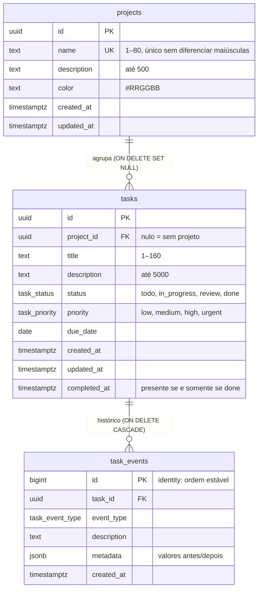
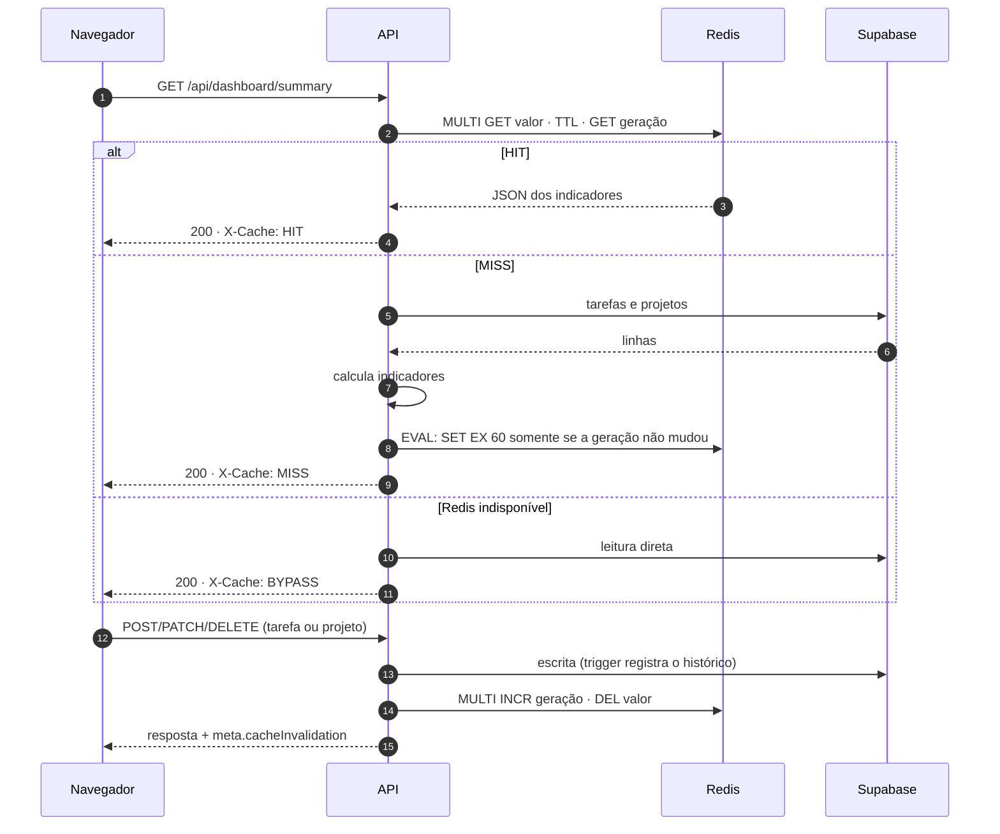

# Arquitetura

## Visão em camadas

```text
React SPA ──HTTP /api──▶ Express
                          ├─ routes/        mapeamento das rotas
                          ├─ controllers/   HTTP ↔ serviços, validação Zod
                          ├─ services/      regras de negócio, invalidação do cache
                          ├─ repositories/  interfaces + implementação Supabase
                          └─ cache/         DashboardCache, RedisCacheStore, métricas
                                   │                 │
                          Supabase (PostgreSQL)    Redis
```

- **`container.ts`** liga as implementações reais (Supabase e Redis) às camadas. **`app.ts`** recebe tudo por injeção, e por isso os testes montam a API com dublês em memória.
- **Repositórios** são o único ponto que conhece o Supabase. Erros do PostgREST são traduzidos em `errors/app-error.ts` (409 para nome duplicado, 422 para restrição, 503 para banco indisponível) sem expor detalhes internos.
- **Serviços** invalidam o cache somente depois que a escrita foi confirmada pelo banco.
- **Front-end**: TanStack Query cuida de cache de requisições, estados e atualização otimista (Kanban e troca de status). Os filtros da lista vivem na URL, e as páginas são carregadas sob demanda.

## Modelo de dados



Esquema completo em [`supabase/migrations/20261026000000_init_schema.sql`](../supabase/migrations/20261026000000_init_schema.sql).

### Regras no banco

| Regra             | Implementação                                                                                                                    |
| ----------------- | -------------------------------------------------------------------------------------------------------------------------------- |
| Domínios fechados | `enum` para status, prioridade e tipo de evento                                                                                  |
| Integridade       | `CHECK` de tamanho e cor; `completed_at` ⇔ `status = 'done'`; nome de projeto único (`lower(btrim(name))`)                       |
| Datas automáticas | Trigger `set_updated_at`; trigger `tasks_sync_completed_at` preenche e limpa `completed_at`                                      |
| Histórico         | Trigger `tasks_log_events` grava eventos em português, na mesma transação da alteração                                           |
| Exclusões         | Projeto excluído → tarefas com `project_id = null`; tarefa excluída → eventos removidos em cascata                               |
| Desempenho        | Índices por projeto, status, prioridade e criação; índice parcial de prazo para tarefas abertas; `pg_trgm` para busca por título |
| Acesso            | RLS habilitado sem políticas e `REVOKE` para `anon`/`authenticated`; apenas a chave secreta do servidor acessa as tabelas        |

## Cache dos indicadores

### Por que Redis

Montar o dashboard exige ler todas as tarefas (em páginas de 1.000 linhas), ler os projetos e agregar status, prioridade, prazos e uma série diária no fuso configurado. Esse resultado é idêntico para todos os acessos até a próxima alteração, e as leituras são muito mais frequentes que as escritas: recarregar a página, voltar o foco à aba, várias abas abertas.

Um cache na memória da API sumiria a cada reinício e não seria compartilhado entre instâncias. O Redis mantém o valor fora do processo, com expiração nativa e operações atômicas, e uma invalidação vale para todas as instâncias de uma vez.

### Fluxo



### Decisões

| Decisão                                              | Motivo                                                                                                                                                                                                                                  |
| ---------------------------------------------------- | --------------------------------------------------------------------------------------------------------------------------------------------------------------------------------------------------------------------------------------- |
| **Cache-aside**                                      | A API controla quando ler, calcular e gravar; o Supabase continua sendo a fonte da verdade                                                                                                                                              |
| **Invalidação na escrita**                           | Quem altera uma tarefa nunca vê indicadores anteriores à alteração                                                                                                                                                                      |
| **TTL de 60 s**                                      | Rede de segurança para alterações feitas fora da API (edição direta no Supabase, invalidação perdida). Limita o atraso a um minuto, aceitável para indicadores, e ainda absorve recargas repetidas. Configurável em `CACHE_TTL_SECONDS` |
| **Chave versionada** `taskflow:v1:dashboard:summary` | Mudar o formato do valor exige só trocar `v1`; as chaves antigas expiram sozinhas                                                                                                                                                       |
| **Contador de geração + Lua**                        | Se uma escrita acontece durante um MISS, o cálculo já nasce desatualizado. O script só grava se a geração lida antes do cálculo ainda for a atual                                                                                       |
| **Falha rápida**                                     | Sem fila offline e com tempo limite de 1 s por comando: com o Redis fora, a requisição segue para o Supabase em vez de esperar                                                                                                          |
| **Invalidação pendente**                             | Uma invalidação que falhou com o Redis fora é refeita na reconexão, para que ele não volte servindo dados antigos                                                                                                                       |
| **Métricas em memória**                              | Contadores de HIT/MISS e linha do tempo do painel ficam no processo da API, separados dos dados em cache                                                                                                                                |

Com autenticação, a chave passaria a incluir o usuário (`taskflow:v1:user:<id>:dashboard:summary`), e cada usuário teria o próprio cache.

### Observabilidade

- Cabeçalhos `X-Cache` e `X-Cache-Duration-Ms` em `/api/dashboard/summary`.
- Logs estruturados (pino) com `cache: HIT | MISS | BYPASS | INVALIDATE`, chave, TTL e duração.
- Painel **Diagnóstico do cache** (`/diagnostics`), protegido por `DIAGNOSTICS_TOKEN`.
- Direto no Redis:

  ```bash
  redis-cli TTL taskflow:v1:dashboard:summary
  redis-cli GET taskflow:v1:dashboard:summary
  redis-cli MONITOR
  ```

## Segurança

- A chave secreta do Supabase fica só em `backend/.env`; o front-end não recebe nenhuma chave.
- RLS + `REVOKE`: mesmo uma chave pública não lê nem escreve nas tabelas.
- Zod com `strictObject`: campos desconhecidos são rejeitados, e o cliente não consegue definir `completed_at`.
- `helmet`, CORS restrito a `CORS_ORIGIN`, 300 requisições/min por IP, corpo JSON até 100 KB.
- O diagnóstico exige token, comparado em tempo constante, e não expõe credenciais nem dados do banco.

## Limitações conhecidas

- Espaço de trabalho único, sem autenticação.
- Alterações feitas fora da API aparecem nos indicadores em até 60 s.
- MISS simultâneos calculam em paralelo; não há lock de recomputação.
- Indicadores agregados na API; para grandes volumes, a agregação deveria ir para o SQL.
- O Kanban carrega até 200 tarefas e não tem ordenação manual dentro da coluna.
- Contadores do painel e limite de requisições são por instância da API.
